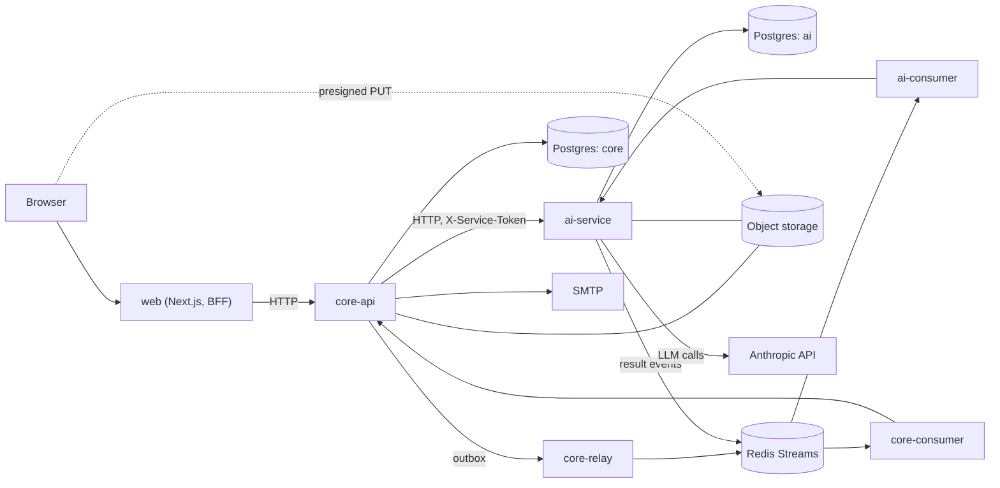

# Essity

Essity is an AI-graded spaced-repetition app for students. A learner uploads course material, organises it into subjects, and studies a daily queue of questions. Answers are written in free text and graded by an LLM against passages of the learner's own material. Each knowledge unit and each practice question is scheduled with FSRS, so the queue follows what the learner actually remembers.

> **Status:** pre-alpha. Interfaces and schemas change. The web UI is in Vietnamese.

## Features

| Area | Summary |
|---|---|
| Accounts | Email and password, email verification and password reset over SMTP. Google sign-in is drawn in the UI but disabled (`apps/web/lib/auth-flags.ts`). |
| Subjects and documents | Upload PDF, DOCX, PPTX and images; ai-service extracts an outline and knowledge units. |
| Knowledge vault (Kho) | AI-drafted cards go straight into the vault, where they can be browsed and edited. The vault is the source of truth. |
| Today | Daily queue ranked by forgetting risk, exam dates and the prerequisite graph. |
| Study sessions | Free-text answers graded with feedback and quoted source anchors. No self-rating. |
| Practice | Questions generated from material or modelled on an imported question bank. Each practice question has its own FSRS schedule. |
| Session notes | Typed or photographed notes turned into session results. |
| Syllabus and commands | Edit the subject outline by hand or with a natural-language command bar. |
| Graph and stats | Prerequisite graph per subject and global; mastery and readiness. |
| Data control | Per-user export and account deletion. |
| AI cost control | Per-user daily and monthly USD quota enforced in ai-service. |

Details: [documentation/PRODUCT.md](documentation/PRODUCT.md).

## Architecture



Synchronous HTTP serves user-facing calls such as grading. Long-running work (indexing, session processing) goes through a transactional outbox and Redis Streams. See [documentation/ARCHITECTURE.md](documentation/ARCHITECTURE.md).

## Tech stack

| Layer | Technology |
|---|---|
| Web | Next.js 16, React 19, TypeScript, Tailwind, Base UI, Cytoscape, pdf.js, KaTeX |
| core-api | Python 3.13, FastAPI, SQLAlchemy 2, Alembic, py-fsrs |
| ai-service | Python 3.13, FastAPI, SQLAlchemy 2, Alembic, Anthropic SDK, pypdfium2 |
| Data | PostgreSQL 18 (one database per service), Redis (Streams, job queue), RustFS (S3-compatible storage) |
| Observability | OpenTelemetry, Jaeger |
| Tooling | uv, pnpm, just, Docker Compose, Vitest, Playwright, pytest, ruff, pyright |
| Production | Docker Compose, Caddy (automatic HTTPS) |

## Repository layout

```
apps/web/              Next.js UI and BFF (app/, app/api/, components/, e2e/)
services/core-api/     FastAPI, source of truth (src/core_api, migrations/, tests/)
services/ai-service/   FastAPI, LLM calls, document processing (src/ai_service, prompts/, evals/)
packages/api-client/   TypeScript client generated from core-api OpenAPI
contracts/             JSON Schemas: events/ (Redis Streams), files/ (object storage)
infra/                 Compose files, Caddy, OTel collector, Postgres roles, storage init
scripts/               Repo checks, API client generation, deploy scripts, workflow tooling
documentation/         Project documentation
```

## Quick start

Prerequisites: Docker, Node.js 24+, pnpm, Python 3.13, [uv](https://docs.astral.sh/uv/), [just](https://github.com/casey/just).

```sh
just env          # create .env from .env.example (fake LLM, Mailpit: no external accounts)
just up           # build and start the stack
just migrate      # core-api migrations
just migrate-ai   # ai-service migrations
```

On a reused Postgres volume, run `just db-roles` once before `just migrate`.

| Service | URL |
|---|---|
| Web | http://localhost:3000 |
| core-api | http://localhost:8000 |
| ai-service | http://localhost:8001 (requires `X-Service-Token`) |
| Mailpit (captured email) | http://localhost:8025 |
| Jaeger (traces) | http://localhost:16686 |
| Object storage console | http://localhost:9001/rustfs/console/ |
| PostgreSQL / Redis | `localhost:5432` / `localhost:6379` |

All ports bind to `127.0.0.1`. Open the web UI through `http://localhost:3000`, not `127.0.0.1` (the origin check rejects it). Register at `/register`; the verification email appears in Mailpit. Other commands: `just ps`, `just logs [service]`, `just down` (keep data), `just reset` (delete data).

## Configuration

Set in `.env` (from `.env.example`); production uses `.env.prod` (from `.env.prod.example`). Compose maps these to per-service variables (`CORE_*`, `AI_*`). Never commit either file.

| Variable | Meaning |
|---|---|
| `POSTGRES_SUPERUSER_PASSWORD` | Postgres superuser password |
| `CORE_DB_*`, `AI_DB_*` | Owner login, password and database name per service |
| `CORE_APP_DB_*` | Restricted runtime login for core-api (no DDL) |
| `CORE_ERASER_LOGIN`, `CORE_ERASER_PASSWORD` | Login used for per-user erasure |
| `REDIS_URL` | Redis connection |
| `S3_ENDPOINT`, `S3_PUBLIC_ENDPOINT` | Storage address for services, and the address the browser reaches (presigned URLs are signed for it) |
| `UPLOAD_ORIGIN` | Storage origin allowed in the web CSP |
| `S3_REGION`, `S3_BUCKET`, `S3_ACCESS_KEY`, `S3_SECRET_KEY` | Object storage settings |
| `AI_SERVICE_URL`, `AI_SERVICE_TOKEN` | core-api to ai-service address and shared token (at least 32 characters) |
| `CORE_API_URL`, `WEB_TO_CORE_TOKEN` | web to core-api address and token (at least 32 characters) |
| `WEB_ORIGIN` | The only origin allowed to send state-changing requests to web |
| `WEB_TRUSTED_PROXY_HOPS` | Number of proxies in front of web (rate-limit client IP) |
| `WEB_DESIGN_PREVIEW` | `1` exposes `/design-preview` outside development |
| `LOG_HASH_KEY` | Key for hashing identifiers in logs; required outside local |
| `SMTP_HOST`, `SMTP_PORT`, `EMAIL_FROM` | Mail server and sender |
| `SMTP_USERNAME`, `SMTP_PASSWORD` | SMTP credentials (production) |
| `AI_LLM_PROVIDER` | `fake` (local and test only), `anthropic`, or `disabled` |
| `ANTHROPIC_API_KEY`, `ANTHROPIC_BASE_URL` | Anthropic key; optional compatible endpoint |
| `AI_QUOTA_DAILY_USD`, `AI_QUOTA_MONTHLY_USD`, `AI_QUOTA_HARD_CAP_FACTOR` | Per-user AI spend limits; empty uses code defaults |
| `DOMAIN`, `ACME_EMAIL` | Production only: public domain and Let's Encrypt contact |
| `GOOGLE_CLIENT_ID`, `GOOGLE_CLIENT_SECRET` | Reserved; Google sign-in is not built |

Outside `local` and `test`, each service refuses to start with local-only values (Mailpit, `localhost`, no STARTTLS, `fake` LLM).

## Testing

| Scope | Command |
|---|---|
| Python services (PostgreSQL and Redis required) | in `services/core-api` or `services/ai-service`: `uv sync --locked`, `uv run ruff check`, `uv run ruff format --check`, `uv run pyright`, `uv run pytest` |
| Web | `pnpm --filter web lint`, `typecheck`, `test` (Vitest), `build` |
| Web e2e (Playwright) | `pnpm --filter web e2e` runs against the standalone build. With `E2E_STACK_URL=http://localhost:3000` set, tests run against a running stack (web, core-api, Mailpit) and no server is started; the email-verification spec needs this. |
| Repo | `just check-imports`, `just check-licenses`, `python scripts/check_alembic_heads.py`, `python -m unittest discover -s scripts -p "test_*.py"` |

## CI

`.github/workflows/ci.yml` runs on push and pull requests: Python checks per service (licences, ruff, pyright, DB roles, migrations on an empty database, pytest), web (client freshness, licences, lint, typecheck, unit tests, build, Playwright), Docker image builds, repo boundary checks, and a gitleaks scan. `ci-ok` fails if any job fails.

## Deployment

Two options, described in [documentation/DEPLOY.md](documentation/DEPLOY.md): a single VPS with `infra/docker-compose.prod.yml` and Caddy (HTTPS through sslip.io or your own domain), or a Cloudflare quick tunnel from a local machine. The full VPS walkthrough is [infra/DEPLOY.md](infra/DEPLOY.md).

## Project rules

- `core-api` and `ai-service` never import each other (`just check-imports`).
- Every LLM call goes through `ai-service` and its quota; each model needs a price in `llm/pricing.py`.
- One Alembic head per service; merged migrations are not edited.
- After changing core-api routes, run `just gen-api`; CI fails on a stale `packages/api-client`.
- No secrets in git; `.env` and `.env.prod` are not committed.
- Tests first; lint, format check and type check before committing. Commit messages in English.

## License

MIT, see [LICENSE](LICENSE).
