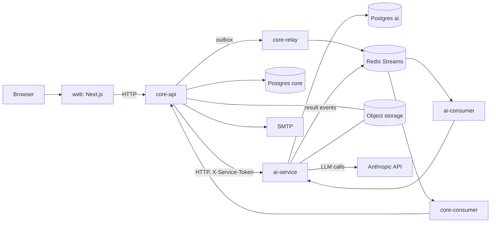

# Architecture

## Components

| Component | Path | Stack | Role |
|---|---|---|---|
| web | `apps/web` | Next.js, TypeScript, Tailwind, shadcn/ui | UI and thin BFF (`app/api/*` route handlers) |
| core-api | `services/core-api` | FastAPI, SQLAlchemy, Alembic, py-fsrs | Auth, subjects, scheduling, grading orchestration; source of truth |
| ai-service | `services/ai-service` | FastAPI, Alembic | LLM calls, PDF/DOCX/PPTX/image processing, quotas, evals |
| api-client | `packages/api-client` | TypeScript | Client generated from core-api OpenAPI (`just gen-api`) |
| contracts | `contracts/` | JSON Schema | Event payloads (`events/`), file formats exchanged through object storage (`files/`) |

core-api and ai-service never import each other; `scripts/check_cross_imports.py` enforces this in CI.

## Processes (Compose)

`infra/docker-compose.yml` runs `postgres`, `redis`, `storage` (RustFS, S3-compatible), `mailpit`, `otel-collector`, `jaeger`, and the application processes `core-api`, `core-migrate`, `core-worker` (background jobs), `core-relay` (outbox to Redis), `core-consumer` (events from ai-service), `ai-service`, `ai-consumer`, `web`.

## Data stores

- PostgreSQL 18, one database per service (`core`, `ai`), one login per service. core-api connects as a restricted `core_app` role; a separate eraser role performs account erasure (`infra/postgres/roles.*`).
- Redis: Streams for events, job queue for core-api, rate-limit state.
- Object storage: uploaded documents and structured results (`contracts/files/`).

## Communication

- Synchronous HTTP for user-facing calls such as grading. core-api calls ai-service with an `X-Service-Token` header; web calls core-api with its own token.
- Asynchronous events over Redis Streams. core-api writes events to a transactional outbox; `core-relay` publishes them to the stream `events.ai`; `ai-consumer` and `core-consumer` read through consumer groups with a delivery limit and a dead-letter stream. Events use a common envelope (`contracts/events/envelope.schema.json`) and are deduplicated.

## Main flows

**Document upload.** The file goes to object storage; core-api emits `document.uploaded`; ai-service extracts text, builds an outline and knowledge units with the LLM, and emits `document.indexed` (or `document.failed`); core-api stores the result.

**Grading.** The learner submits a free-text answer; core-api sends it with source passages to ai-service `/v1/grade`; ai-service checks quota, calls the model, verifies that quoted anchors exist in the source, and returns the grade; core-api records the attempt and updates the unit's FSRS state.

**Today.** core-api computes the queue from FSRS state, exam dates and the prerequisite graph (`domain/today_v2.py`, `domain/readiness.py`).

## Background jobs (core-worker)

In `core_api/jobs/`: email sending, FSRS parameter optimisation (weekly), cleanup of documents, notes and outbox, purge of unverified accounts, erase-user sweep, retries for submissions and practice grading.

## Observability and safety

OpenTelemetry traces go to Jaeger locally. Logs hash identifiers with `LOG_HASH_KEY`. Services refuse to start outside `local`/`test` with local-only settings. CI scans git history with gitleaks and blocks GPL/AGPL dependencies (`scripts/check_licenses.py`).
