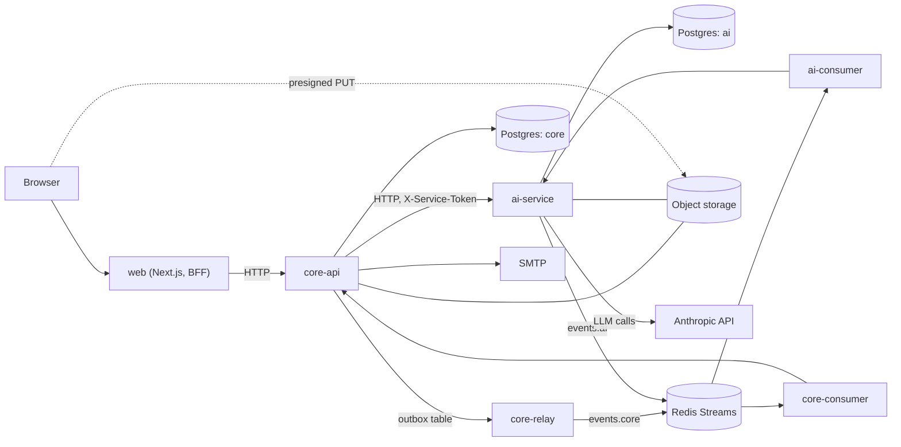
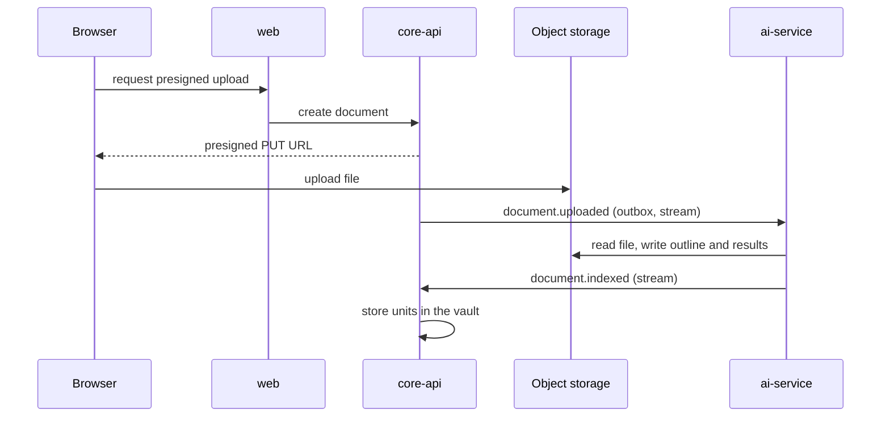

# Architecture

## Components

| Component | Path | Stack | Role |
|---|---|---|---|
| web | `apps/web` | Next.js, TypeScript, Tailwind | UI and thin BFF (`app/api/*` route handlers). The browser talks only to web. |
| core-api | `services/core-api` | FastAPI, SQLAlchemy, Alembic, py-fsrs | Auth, subjects, scheduling, grading orchestration; source of truth |
| ai-service | `services/ai-service` | FastAPI, SQLAlchemy, Alembic | LLM calls, PDF/DOCX/PPTX/image processing, quotas, evals |
| api-client | `packages/api-client` | TypeScript | Client generated from the core-api OpenAPI schema (`just gen-api`) |
| contracts | `contracts/` | JSON Schema | `events/`: Redis Stream payloads; `files/`: formats exchanged through object storage |

core-api and ai-service never import each other; `scripts/check_cross_imports.py` enforces this in CI. They share only the contracts, and each checks its own models against the schemas in tests.

## Processes (Docker Compose)

`infra/docker-compose.yml` is the local stack.

| Process | Role |
|---|---|
| `postgres` | PostgreSQL 18; databases `core` and `ai`, roles created by `infra/postgres/` |
| `redis` | Streams, core-api job queue, rate-limit state |
| `storage`, `storage-init` | RustFS (S3-compatible); bucket created at start |
| `mailpit` | Captures outgoing email (local only) |
| `otel-collector`, `jaeger` | Traces (local only) |
| `core-migrate` | Alembic for core; the only process that connects as the schema owner |
| `core-api` | HTTP API |
| `core-worker` | Background jobs |
| `core-relay` | Publishes the outbox to the stream `events.core` |
| `core-consumer` | Consumes `events.ai` into core-api |
| `ai-service` | HTTP API for grading and commands |
| `ai-consumer` | Consumes `events.core` into ai-service |
| `web` | Next.js standalone server |

`infra/docker-compose.prod.yml` is an override for production: it adds `caddy` (the only published ports, 80 and 443), removes published ports from everything else, parks Mailpit, Jaeger and the collector behind a `dev-only` profile, and sets `*_ENVIRONMENT=production`. See [DEPLOY.md](DEPLOY.md).

## Data stores

- **PostgreSQL**, one database per service, one login per service. core-api runs as a restricted `core_app` role (no DDL, cannot disable append-only triggers); a separate eraser role performs account erasure (`infra/postgres/roles.sql`, `roles.sh`). Each service has one Alembic head (`scripts/check_alembic_heads.py`).
- **Redis**: Streams for events, the core-api job queue, rate-limit state.
- **Object storage**: uploaded documents, extracted outlines and page text, and structured results (`contracts/files/`). The browser uploads and downloads through presigned URLs signed for `S3_PUBLIC_ENDPOINT`.

## Communication

- **Synchronous HTTP.** web calls core-api with `WEB_TO_CORE_TOKEN` (header `X-Service-Token`); core-api trusts the client IP forwarded by web according to `WEB_TRUSTED_PROXY_HOPS`. core-api calls ai-service with `AI_SERVICE_TOKEN`, for grading and commands.
- **Asynchronous events.** core-api writes events to a transactional `outbox` table in the same transaction as the state change. `core-relay` appends them to `events.core`; ai-service publishes to `events.ai`. Consumers use consumer groups with a delivery limit and a dead-letter stream, and deduplicate by `event_id`. All events share one envelope (`contracts/events/envelope.schema.json`) and carry identifiers and object keys, not content (claim-check).

| Stream | Written by | Read by | Events |
|---|---|---|---|
| `events.core` | core-relay | ai-consumer | `document.uploaded`, `session.confirmed`, `submission.created`, `unit.saved`, `grade.requested`, `user.deleted` |
| `events.ai` | ai-service | core-consumer | `document.indexed`, `document.failed`, `session.progress`, `session.processed`, `session.failed`, `submission.processed`, `submission.failed`, `grade.completed` |

## Main flows

**Document upload.** The file goes straight to object storage. core-api emits `document.uploaded`; ai-service extracts text, builds an outline and knowledge units with the LLM, and emits `document.indexed` or `document.failed`; core-api stores the result in the vault.

**Grading.** The learner submits a free-text answer. core-api sends it with source passages to ai-service `/v1/grade`; ai-service checks the quota, calls the model, verifies that quoted anchors exist in the source, and returns the grade. core-api records the attempt and updates FSRS state. Practice answers follow the same path with `grade_practice` and update the question's own schedule.

**Today.** core-api computes the queue from FSRS state, exam dates and the prerequisite graph (`domain/today_v2.py`, `domain/readiness.py`).

**Email.** Registration and password reset enqueue a `send_email` job; `core-worker` sends it over SMTP (Mailpit locally, Gmail SMTP with an App Password in production). Verification links use `CORE_WEB_BASE_URL`, which must be an `https://` URL outside local and test.

## Background jobs (`core-worker`)

Defined in `core_api/jobs/`: email sending, weekly FSRS parameter optimisation, cleanup of documents, notes and outbox, purge of unverified accounts, erase-user sweep, retries for submissions and practice grading, question-bank import, unit-edge proposals, review-question regeneration.

## Observability and safety

- OpenTelemetry traces go to Jaeger locally; trace context travels in event envelopes.
- Logs hash identifiers with `LOG_HASH_KEY`.
- State-changing requests to web are accepted only from `WEB_ORIGIN`; login and other sensitive routes are rate-limited per client IP (`security/rate_limit.py`).
- Each service validates its environment at start (`CORE_ENVIRONMENT`, `AI_ENVIRONMENT`) and refuses local-only values outside `local` and `test`.
- CI scans git history with gitleaks and blocks GPL/AGPL dependencies (`scripts/check_licenses.py`).
