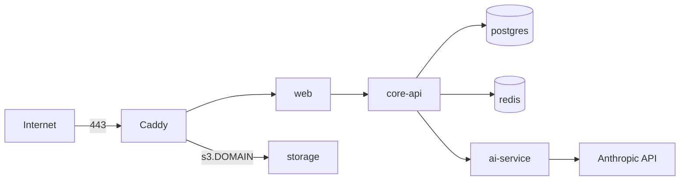

# Deployment

Two supported options. Both are small-scale setups (demo, review, a few users), not a hardened production platform.

| Option | Use when | Public address |
|---|---|---|
| [VPS](#option-1-single-vps) | A stable public deployment | `https://<ip>.sslip.io` or your domain |
| [Cloudflare quick tunnel](#option-2-cloudflare-quick-tunnel-from-a-local-machine) | Showing the local stack for a few hours | Random `*.trycloudflare.com` URLs |

Production rules apply to both when `*_ENVIRONMENT=production`: https URLs, a real SMTP host with STARTTLS, secrets of at least 32 characters, no `fake` LLM provider.

## Option 1: single VPS

Compose override `infra/docker-compose.prod.yml` on top of `infra/docker-compose.yml`, with Caddy terminating HTTPS.



Only Caddy publishes ports (80, 443). Postgres, Redis, storage and the app services are internal. Mailpit, Jaeger and the collector are not started. Caddy serves `DOMAIN` (to web) and `s3.DOMAIN` (to storage, for presigned browser uploads) with automatic certificates (`infra/caddy/Caddyfile`).

### Requirements

| Item | Notes |
|---|---|
| VPS | Ubuntu 22.04 or 24.04, at least 2 vCPU, 4 GB RAM, 30 GB disk, public IPv4; ports 80 and 443 open in the provider firewall |
| Gmail App Password | For verification and password-reset email (Gmail SMTP with an App Password; requires 2-Step Verification) |
| Anthropic API key | For grading; or set `AI_LLM_PROVIDER=disabled` (grading answers 503) |
| Domain | Optional. Without one, `<ip>.sslip.io` resolves to the IP and HTTPS works with no DNS setup |

### Steps

```sh
# 1. Bootstrap once: installs Docker, firewall, swap, clones to /opt/essity, writes /opt/essity/.env.prod
REPO_URL=https://github.com/<owner>/<repo>.git bash scripts/deploy/bootstrap.sh

# 2. Fill the human values
nano /opt/essity/.env.prod   # ACME_EMAIL, SMTP_USERNAME, SMTP_PASSWORD, EMAIL_FROM, ANTHROPIC_API_KEY

# 3. Build, migrate, start, wait for health
cd /opt/essity && bash scripts/deploy/up.sh
```

`up.sh` builds images, refreshes database roles, runs migrations for core and ai, starts the stack and polls `https://<domain>/api/health`. Update with `git pull && bash scripts/deploy/up.sh`.

Own domain: create A records for `app.example.com` and `s3.app.example.com`, then bootstrap with `DOMAIN=app.example.com`.

### Production settings that matter

| Variable | Requirement |
|---|---|
| `DOMAIN`, `ACME_EMAIL` | Public host and certificate contact |
| `S3_PUBLIC_ENDPOINT`, `UPLOAD_ORIGIN` | `https://s3.<domain>`; web bakes the origin in at build time, so rebuild after changing it |
| `WEB_TRUSTED_PROXY_HOPS` | `1` (Caddy). With `0`, all users share one rate-limit bucket |
| `SMTP_*`, `EMAIL_FROM` | Real host with STARTTLS (not port 465); sender on a real domain |
| `LOG_HASH_KEY`, tokens, DB passwords | Random, at least 32 characters; generated by bootstrap |

### Operations

```sh
alias dc='docker compose --env-file .env.prod -f infra/docker-compose.yml -f infra/docker-compose.prod.yml'
dc ps
dc logs -f --tail 100 web core-api
dc exec -T postgres pg_dump -U postgres core > core.sql   # also: ai
```

Data lives in Docker volumes `essity_postgres-data`, `essity_storage-data`, `essity_redis-data`. There are no automated backups or monitoring.

### Troubleshooting

| Symptom | Check |
|---|---|
| Certificate error or unreachable | Ports 80 and 443 in the provider panel; `dc logs caddy`; Let's Encrypt rate limits on shared sslip.io hosts (retry later or use your own domain) |
| No verification email | `dc logs core-api core-worker`; wrong App Password or 2-Step Verification off |
| core-api exits at start | `dc logs core-api`: a production validation failed (https URLs, SMTP host, secret length) |
| Browser upload fails | `S3_PUBLIC_ENDPOINT` must be `https://s3.<domain>` and resolve to the server; re-run `up.sh` |
| Build killed (out of memory) | Confirm swap with `free -h`; re-run `up.sh` |
| Everyone locked out after wrong passwords | `WEB_TRUSTED_PROXY_HOPS` must be `1` |

The full walkthrough is in [`infra/DEPLOY.md`](../infra/DEPLOY.md).

## Option 2: Cloudflare quick tunnel from a local machine

Expose the local Compose stack with Cloudflare quick tunnels. URLs are random and change on every start. Use it for demos, not for storing real data.

Two tunnels are needed: one to web (`web:3000`) and one to storage (`storage:9000`), because browsers upload files straight to storage with presigned URLs.

1. Start the stack: `just env && just up && just migrate && just migrate-ai`.
2. Start a tunnel for each target with the `cloudflare/cloudflared` image on the Compose network (`essity_default`):

   ```sh
   docker run -d --name tunnel-web --network essity_default \
     cloudflare/cloudflared:latest tunnel --no-autoupdate --url http://web:3000
   docker run -d --name tunnel-s3 --network essity_default \
     cloudflare/cloudflared:latest tunnel --no-autoupdate --url http://storage:9000
   docker logs tunnel-web 2>&1 | grep trycloudflare.com
   docker logs tunnel-s3 2>&1 | grep trycloudflare.com
   ```

3. In `.env`, set the tunnel URLs:

   | Variable | Value |
   |---|---|
   | `S3_PUBLIC_ENDPOINT` | the storage tunnel URL |
   | `UPLOAD_ORIGIN` | the storage tunnel URL |
   | `WEB_ORIGIN` | the web tunnel URL |
   | `CORE_WEB_BASE_URL` | the web tunnel URL, used in email links. `infra/docker-compose.yml` does not pass it (the default is `http://localhost:3000`), so add `CORE_WEB_BASE_URL: <url>` to `core-api` and `core-worker` in a local override file (`-f infra/docker-compose.yml -f <override>`) |

4. Rebuild and restart: `just up` (web reads `UPLOAD_ORIGIN` at build time, so it must be rebuilt). Open the web tunnel URL.

Stop with `docker rm -f tunnel-web tunnel-s3`. Mail still goes to Mailpit unless SMTP is configured.
